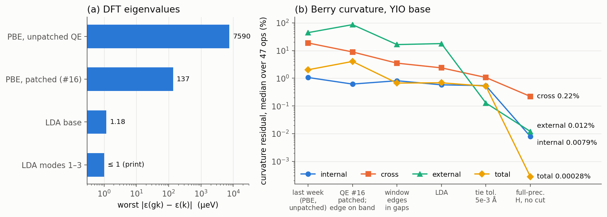
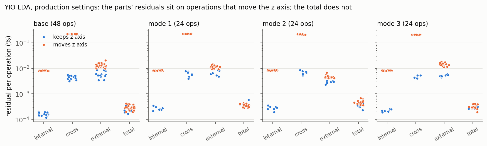
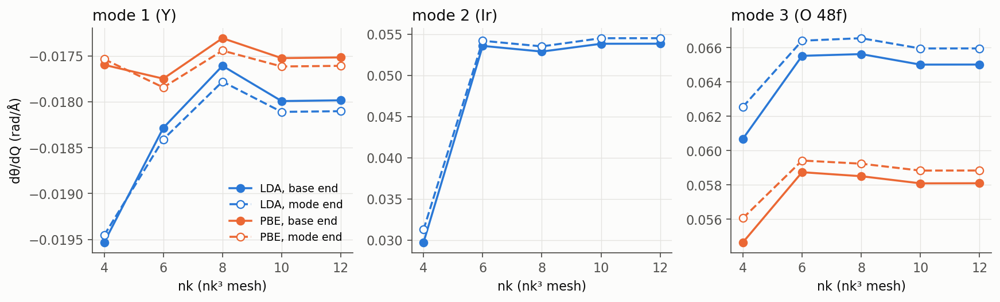
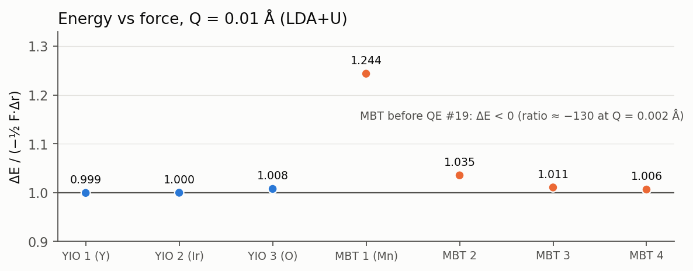
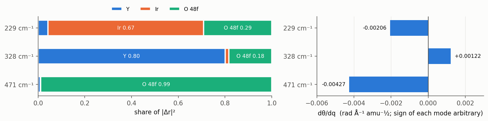

# Meeting notes: progress since 2026-10-07 (prepared 10-12, updated 10-14)

## Summary

1. **Last week:** YIO's Berry curvature broke its magnetic symmetry. We had found a QE bug (#16) and expected the patch to remove the problem.
2. **The patch alone didn't remove it.** Two more causes were left, both in the Wannier stage. With all of them fixed, YIO's curvature is **exactly symmetric** (0.000%) for the base and all three displaced structures.
3. **So YIO has its first valid dθ/dQ** for all three Γ₂⁻ modes. It is converged in k and changes little between LDA and PBE. The same forces also give the physical Γ₂⁻ phonons, and so dθ per physical mode.
4. **MBT:** its DFT is now clean, after a QE k-point bug and a switch from PBE to LDA. It is waiting on the 8×8×8 NSCFs (done ~10-17).
5. **θ itself (§6, new 10-14):** the MBT base Wannier model has θ = π (inversion parities). The Chern–Simons 3-form,
   computed with an exact connection in a smooth gauge, gives an independent dθ/dQ for YIO: mode 1 agrees with the c₂
   integral for all three modes at nk = 10 (0.09%, 0.25%, 0.003%). For MBT's θ = π it needs too fine a mesh to be practical.

Figures: `2026-10-12_figures/`, made by `make_figures.py` there.

---

## 1. Definitions

### The response

The axion response is a BZ integral of (k-space Berry curvature) × (mixed k–phonon curvature) of the $M$ occupied
bands (`theory/derivation.md`, eq. 39):

$$
\frac{\partial\theta}{\partial\beta}
=\frac{1}{4\pi}\int_{\rm BZ}d^3k\;\epsilon^{ijl}\,{\rm tr}\big[\mathcal{B}_{ij}(\mathbf k)\,\mathcal{B}_{l\beta}(\mathbf k)\big],
$$

where $\mathcal B_{\mu\nu}$ is the $M\times M$ non-Abelian curvature, and $i,j,l$ run over the three k directions.

**The displacement:** a basis mode $j$ moves atom $a$ by

$$
\Delta\mathbf r_a = Q\,\mathbf v_{j,a},\qquad Q = 0.01\ \text{Å},
$$

where $\mathbf v_j$ is the SMODES vector (Cartesian entries $\pm1$).

**The $\beta$ derivative:** a secant between two Wannier models in one shared gauge ($\mathcal A_\beta = 0$, frozen
gauge):

$$
\partial_\beta \mathbb H(\mathbf R)\approx\frac{\mathbb H^{(Q)}(\mathbf R)-\mathbb H^{(0)}(\mathbf R)}{Q},
\qquad
\partial_\beta \mathbb A(\mathbf R)\approx\frac{\mathbb A^{(Q)}(\mathbf R)-\mathbb A^{(0)}(\mathbf R)}{Q}.
$$

**Two estimates** of $\partial\theta/\partial Q$ use the same secant. They differ only in where the k-space
ingredients (bands, eigenvectors, $\mathcal B_{ij}$) are evaluated: at the base ($\theta'_0$, "base end") or at the
displaced structure ($\theta'_Q$, "mode end"). We report the midpoint value

$$
\bar\theta' = \tfrac12\big(\theta'_0+\theta'_Q\big) = \theta'(Q/2) + O(Q^2).
$$

$\theta'_0$ and $\theta'_Q$ differ by $Q\,\theta''$, so their spread measures how linear the response is across the
step. It is not a validity test.

### The symmetry test

Each crystal has a magnetic point group:
- **YIO base:** $m\bar3m'$ (48 operations).
- **YIO displaced:** $\bar4'3m'$ (24 operations, no inversion).
- **MBT base:** $\bar3m'$ (12 operations).

Every quantity must obey it. **Symmetry is never imposed**, so a pass means every stage before it is right. For an
operation $g$ with rotation $R$, set $s_g=-1$ if $g$ includes time reversal (primed) and $+1$ otherwise. Then

$$
g\mathbf k = s_g R\mathbf k,\qquad
\varepsilon_n(g\mathbf k)=\varepsilon_n(\mathbf k),\qquad
\boldsymbol\Omega(g\mathbf k)=s_g\det(R)\,R\,\boldsymbol\Omega(\mathbf k).
$$

Here $\boldsymbol\Omega$ is the traced curvature, an axial vector. We test three levels:

1. **DFT eigenvalues** on the 8×8×8 mesh: $\Delta\varepsilon=\max_{n,\mathbf k,g}|\varepsilon_n(g\mathbf k)-\varepsilon_n(\mathbf k)|$.
   This tests QE alone.
2. **Interpolated bands** at 7 random k between mesh points. This tests the Wannier model.
3. **Curvature** at the same 7 k. For each operation,

   $$
   r_g=\frac{\max_{\mathbf k,a}\big|\Omega_a(g\mathbf k)-[s_g\det(R)\,R\,\boldsymbol\Omega(\mathbf k)]_a\big|}{\max_{\mathbf k,a}|\Omega_a(\mathbf k)|},
   $$

   reported as the median over the non-identity operations.
   - **The parts:** $r_g$ is computed for the total and for each of its three parts,
     $\boldsymbol\Omega=\boldsymbol\Omega^{\rm int}+\boldsymbol\Omega^{\rm cross}+\boldsymbol\Omega^{\rm ext}$:
     - **internal:** from $\mathbb H(\mathbf R)$ only;
     - **external:** from the position matrix $\mathbb A(\mathbf R)$ only;
     - **cross:** mixed.
   - **Calibration:** a wrong operation gives $r\approx200\%$, so the test discriminates.

## 2. YIO symmetry: from 2% to exact

### DFT eigenvalues (worst operation)

| run | operations | $\Delta\varepsilon$ |
|---|---|---|
| PBE, unpatched QE (old base 192344) | 48 | 7.59 meV |
| PBE, patched QE (#16) | 48 | 137 μeV |
| **LDA, patched QE (production base)** | 48 | **1.18 μeV** |
| **LDA, displaced modes 1–3** | 24 | **≤ 1 μeV** (the print precision) |

The #16 bug (last week) is in the PAW part of the GGA. LDA has no density gradients, so it avoids that code path
entirely: it is 100× more symmetric than patched PBE.

### Curvature (base, median of $r_g$ over 47 operations, %)

| step | internal | cross | external | total |
|---|---|---|---|---|
| last week: unpatched PBE DFT, tie tolerance $10^{-3}$ Å | 1.06 | 18.7 | 44.2 | 2.02 |
| QE patched (#16), but a window edge on a band | 0.61 | 8.9 | 85.9 | 4.04 |
| window edges moved into gaps | 0.81 | 3.50 | 16.4 | 0.67 |
| LDA instead of PBE | 0.58 | 2.37 | 17.8 | 0.68 |
| tie tolerance $5\times10^{-3}$ Å | 0.54 | 1.06 | 0.13 | 0.52 |
| **$\mathbb H(\mathbf R)$ at full precision, no hopping cut (production)** | **0.008** | **0.22** | **0.012** | **0.0003** |
| same, PBE | 0.01 | 0.40 | 0.25 | 0.01 |

All rows use the production $\mathbb A(\mathbf R)$ (`transl_inv_full_from_chk`). Last week's 1.6% used the `.mmn`
formula (`right_centre_from_chk`, then the default by accident).

**The displaced structures** (production settings, median over 23 operations of $\bar4'3m'$, %):

| | internal | cross | external | total |
|---|---|---|---|---|
| LDA mode 1 (Y) | 0.008 | 0.22 | 0.011 | 0.000 |
| LDA mode 2 (Ir) | 0.008 | 0.21 | 0.004 | 0.000 |
| LDA mode 3 (O) | 0.008 | 0.21 | 0.013 | 0.000 |
| PBE mode 1 | 0.012 | 0.40 | 0.21 | 0.011 |
| PBE mode 3 | 0.012 | 0.36 | 0.14 | 0.011 |

**Why the parts are not exact while the total is:**
- **What the split depends on:** the split into internal / cross / external depends on $\boldsymbol\tau$, the orbital
  positions used to build $H(\mathbf k)$. The total does not.
- **Why $\boldsymbol\tau$ is slightly off:** it is taken from the Wannier centres. The centres of same-site spin
  partners differ by ~$5\times10^{-4}$ Å.
- **Which operations it affects:** only the operations that move the z axis (orange in the figure: 32 of 47 in the
  base, 16 of 23 in each mode). There the cross part is 0.21–0.22%; under the operations that keep z it is ≤ 0.01%.
- **The total:** $\le 7\times10^{-4}\%$ for every operation of every structure.

### What fixed it

**Window edge on a band (new).**
- **The setting:** Wannier90 keeps every DFT state with $\varepsilon_n(\mathbf k)<E_{\rm froz}$ (`dis_froz_max`)
  exactly in the Wannier subspace $\mathcal W(\mathbf k)$. A state above it enters only partially, through the
  projection onto the trial orbitals.
- **The problem:** in the first patched PBE run, band 178 sat on the edge at a whole star
  $\{g\mathbf k\}$ of symmetry-equivalent points:

  $$
  \varepsilon_{178}(g\mathbf k)-E_{\rm froz}\in[-0.01,\;+0.16]\ \text{meV},
  $$

  with $E_{\rm froz} = 15.0$ eV. Symmetry says $\varepsilon_{178}$ is the same at all of them. In the DFT it differs by
  up to ~0.1 meV, PBE's remaining symmetry noise (table above).
- **Effect:** that noise decided which side of the edge the band fell on:
  - at some k-points of the star it was just below the edge, so it was frozen;
  - at the others it was just above, so it was not.

  So $\mathcal W(g\mathbf k)\neq U_g\,\mathcal W(\mathbf k)$, and the model broke symmetry.
- **Which operations broke:** the pattern matches. Sign flips (mmm) keep each k-point in its own group (frozen or
  not), so they stayed fine. Axis permutations (the threefold rotations, C4 about x and z) move k-points between the
  groups, so they broke (external 86%).
- **Fix:** every window edge now sits in an eigenvalue gap at least 40 meV wide in every structure. No band is near
  an edge, so noise can't decide anything.

**Tie tolerance $5\times10^{-3}$ Å (#13).**
- **Why images exist:** an $N^3$ mesh fixes each hopping only up to a supercell translation $\mathbf T\in N\,\mathbb Z^3$.
- **The fold:** the interpolation spreads the weight equally over the shortest images,

  $$
  w_{\mathbf T}=\frac{1}{n}\quad\text{for all }\mathbf T\text{ with }\ d_{\mathbf T}<d_{\min}+\delta,
  \qquad d_{\mathbf T}=|\mathbf R+\mathbf T+\boldsymbol\tau_t-\boldsymbol\tau_s|,
  $$

  where $n$ is the number of such images.
- **The measurement:** across all candidate images, the excess lengths $d_{\mathbf T}-d_{\min}$ are
  $\le1.7\times10^{-3}$ Å (noise) or $\ge2.1\times10^{-2}$ Å (genuinely different), with nothing in between.
- **The fix:** $\delta=5\times10^{-3}$ Å sits in that empty range. External part 17.8% → 0.13%.

**Hopping truncation (#22, new).**
- **Two truncations:** Wannier90's `_hr.dat` prints hoppings to $10^{-6}$ eV, and PythTB dropped every element below
  $h_c=10^{-5}$ eV. Both act element by element in the spin-up/spin-down basis:
  $\mathcal T(H)_{ij}=H_{ij}\,\Theta(|H_{ij}|-h_c)$.
- **Why that breaks symmetry:** a symmetry acts as $H\to U_gHU_g^\dagger$.
  - If $U_g$ keeps the spin axis, it is a phase times a permutation, so it maps one element onto one element and
    $\mathcal T(U_gHU_g^\dagger)=U_g\,\mathcal T(H)\,U_g^\dagger$.
  - If $U_g$ mixes spin up and down, it maps an element onto a combination of elements, so that equality fails.
- **Fix:** $\mathbb H(\mathbf R)$ is now built from the Wannier90 checkpoint (`.chk` + `.eig`) at full precision, with
  no cut. Internal part 0.54% → 0.008%.

## 3. YIO result: dθ/dQ for the three Γ₂⁻ basis modes

$\bar\theta'$ at nk = 12, rad/Å:

| mode | moving atoms | LDA+U (production) | PBE+U | PBE relative to LDA |
|---|---|---|---|---|
| 1 | Y | **−0.0180** | −0.0176 | 3% smaller |
| 2 | Ir | **+0.0542** | (SCF never converged) | — |
| 3 | O 48f | **+0.0655** | +0.0585 | 11% smaller |

These numbers pass three checks, each comparing a different pair of quantities:
- **Finite difference (within one functional):**
  - **The two estimates:** $\theta'_0$ and $\theta'_Q$ agree to 0.7% / 1.2% / 1.4% (LDA modes 1/2/3), so
    Q = 0.01 Å is in the linear regime.
  - **k-convergence:** every value changes by ≤ 0.05% between nk 10 and 12.
- **Functional (LDA vs PBE):** the "3%" and "11%" in the last column compare the two functionals (orange vs blue in
  the figure). Same sign, similar size, so the result does not hinge on the functional.
- **Before vs after the fixes:** PBE mode 3 was +0.169 before the fixes, 2.9× the corrected value. Mode 1 barely
  moved.

## 4. New: the physical Γ₂⁻ phonons and dθ per physical mode

### Forces with noncollinear DFT+U work

**Why this is new.** Our notes recorded that QE couldn't compute forces with noncollinear magnetism + Hubbard U
(`tprnfor`), so we had only the SMODES basis vectors, not the physical modes.
- **What QE 7.6 actually checks:** `force_hub.f90` refuses only four cases. None applies to us: our projectors are
  atomic, there is no Hund's J, no background states and no gamma-only run.
- **What our runs show:** they print a "Hubbard contrib. to forces" term.

**The forces are right:** they pass an independent check. Integrating the force along a straight path from a
zero-force base gives, through third order,

$$
\Delta E = E(Q)-E(0)\approx-\tfrac12\big(\mathbf F^{(0)}+\mathbf F^{(Q)}\big)\cdot\Delta\mathbf r,
$$

and $\mathbf F^{(0)}\cdot\Delta\mathbf r=0$ for any non-totally-symmetric mode.

- **YIO:** the three LDA modes give 0.999 / 1.000 / 1.008.
- **MBT:** modes 2–4 give 1.006–1.035. Mode 1 (Mn) gives 1.24; its ΔE is only 0.02 mRy, and the SCF force
  correction is ~1e-5 Ry, so this is within its force precision.

### The calculation

Script: `archive/diagnostics/2026-10-12_yio_lda_modes/dynmat/gm2_dynmat.py`.

1. **The subspace.** Γ₂⁻ appears three times in YIO, spanned by $\mathbf v_1$ (Y, 4 atoms), $\mathbf v_2$ (Ir, 4 atoms)
   and $\mathbf v_3$ (O 48f, 12 atoms). Force constants are time-even and the full $Fd\bar3m$ block-diagonalizes them,
   so the 3×3 problem in this basis is exact.

2. **Force constants** from the three displaced SCFs ($Q_j = 0.01$ Å along $\mathbf v_j$). The base has no Γ₂⁻
   force, so

   $$
   \Phi_{ij}=\frac{\partial^2E}{\partial Q_i\,\partial Q_j}\approx-\frac{\mathbf v_i\cdot\mathbf F(Q_j)}{Q}.
   $$

   In eV/Ų:

   $$
   \Phi=\begin{pmatrix}
   439.25 & 30.04 & 43.31\\
   29.93 & 492.43 & -63.13\\
   44.75 & -63.22 & 149.27
   \end{pmatrix}.
   $$

   - **Symmetry check:** $\Phi$ is symmetric to $|\Phi-\Phi^{\rm T}|/|\Phi| = 0.3\%$, as it must be. A one-sided
     difference is good to $O(Q^2)$ here, because Γ₂⁻ has no cubic invariant.
   - **Symmetrized:** we use $\Phi^{\rm s}=\tfrac12(\Phi+\Phi^{\rm T})$, with off-diagonals 29.98 (Y–Ir), 44.03 (Y–O)
     and −63.17 (Ir–O).

3. **Mass matrix:** $M_{ij}=\sum_a m_a\,\mathbf v_{i,a}\cdot\mathbf v_{j,a}$. The modes move disjoint atoms, so it is
   diagonal. Each Y and Ir has $|\mathbf v_a|^2=3$, and each O has 1:

   $$
   M=\mathrm{diag}\big(12\,m_{\rm Y},\;12\,m_{\rm Ir},\;12\,m_{\rm O}\big)=\mathrm{diag}(1066.87,\;2306.60,\;191.99)\ \text{amu}.
   $$

4. **Dynamical matrix** $D=M^{-1/2}\Phi^{\rm s}M^{-1/2}$, in eV Å⁻² amu⁻¹:

   $$
   D=\begin{pmatrix}
   0.4117 & 0.0191 & 0.0973\\
   0.0191 & 0.2135 & -0.0949\\
   0.0973 & -0.0949 & 0.7775
   \end{pmatrix}.
   $$

   - **Eigenvalues:** $\omega^2 = 0.1921,\ 0.3960,\ 0.8146$ eV Å⁻² amu⁻¹.
   - **Frequencies:** with $1\ \sqrt{\text{eV Å}^{-2}\text{amu}^{-1}}/2\pi c = 521.5$ cm⁻¹, these are
     **229, 328 and 471 cm⁻¹**.

5. **Eigenvectors:** solve $\Phi^{\rm s}\mathbf c=\omega^2M\mathbf c$, normalized so that
   $\mathbf c^{\rm T}M\mathbf c=1$. The mass-weighted normal coordinate $q$ (Å amu^½) then moves the basis amplitudes as
   $Q_i=c_i\,q$:

   $$
   \mathbf c_{229}=\begin{pmatrix}0.00509\\-0.02017\\-0.01333\end{pmatrix},\quad
   \mathbf c_{328}=\begin{pmatrix}-0.02939\\-0.00420\\0.01404\end{pmatrix},\quad
   \mathbf c_{471}=\begin{pmatrix}-0.00691\\0.00302\\-0.06952\end{pmatrix}\ \text{amu}^{-1/2}.
   $$

6. **dθ per physical mode:** θ is linear in the displacement, so with the §3 values,

   $$
   \frac{d\theta}{dq}=\sum_i c_i\,\frac{\partial\theta}{\partial Q_i}.
   $$

| ω (cm⁻¹) | dominant motion (Y / Ir / O share of $\|\Delta\mathbf r\|^2$) | dθ/dq (rad Å⁻¹ amu⁻½) |
|---|---|---|
| 229 | Ir (0.04 / 0.67 / 0.29) | −0.00206 |
| 328 | Y (0.80 / 0.02 / 0.18) | +0.00122 |
| 471 | O (0.01 / 0.00 / 0.99) | −0.00427 |

- **Caveat 1:** the base is the experimental structure, not relaxed in LDA+U. $\Phi$ is evaluated there.
- **Caveat 2:** the sign of each $\mathbf c$, and so of dθ/dq, is arbitrary.

## 5. MnBi₂Te₄: DFT is clean

**PBE → LDA+U (#18).**
- **Why noncollinear:** with spin–orbit coupling, MBT must run noncollinear.
- **The spurious state:** there, PBE has a state 55 mRy *below* the physical one, in which the two Mn layers stop
  being mirror images. A random start falls into it: |m|abs drifts from 10.3 to 13 μB and the SCF never converges.
- **Why QE can't prevent it:** the symmetry that forbids it is the anti-translation $\{1'|\tfrac12\tfrac12\tfrac12\}$
  (a half-cell translation combined with time reversal), and QE can't enforce that.
- **The modes:** the T₂⁻ modes break that symmetry physically, so in PBE nothing protects them.
- **LDA:** has no such state. The LDA+U base converged in 12 iterations.

**QE k-point bug (#19, new, one-line patch).**
- **The bug:** a September 2025 QE change builds the k-point set wrongly when some rotations appear only combined
  with time reversal, which is the case for the MBT T₂⁻ structures. QE never generated $-\mathbf k$, so it used 13
  k-points instead of 16, and gave the remaining ones double weight.
- **Effect:** the displaced structures came out 0.2–0.3 mRy *below* the base. That is impossible, because a
  displacement from equilibrium costs $\tfrac12\Phi Q^2>0$.
  - **The tell:** on the energy-vs-force check (§4), a Q = 0.002 Å test gave ΔE = −0.311 mRy against a force estimate
    of +0.0024 mRy, a ratio of ≈ −130.
- **After the patch:** all four modes sit above the base, at 1.006–1.24 (figure in §4). YIO's k-point lists are
  unaffected.

**Symmetry:**

| | result |
|---|---|
| DFT eigenvalues, LDA base, 12 operations | 0.043 μeV |
| Kramers pairs (test of $\{1'\|\tfrac12\tfrac12\tfrac12\}$) | split by ≤ 20 μeV |
| curvature parts | **not available yet** (see below) |

- **Why the base can't be tested:** its curvature is zero by symmetry (inversion × time reversal), ~$10^{-6}$ of the
  per-band scale. A percentage residual there is noise divided by noise.
- **The first real test:** the T₂⁻ modes break that symmetry, so they give the first MBT curvature test.

**Next:** the 8×8×8 NSCFs for the base and four modes started 10-12 (~4.7 days, so ~10-17). Then Wannierize, run the
mode symmetry check, and compute dθ.

## 6. New (10-14): the axion angle θ itself

Scripts: `archive/diagnostics/2026-10-14_cs_theta/`. All runs use the production models ($\mathbb H(\mathbf R)$
from the `.chk`, no hopping cut; MBT positions pinned to the atoms).

### MBT base: θ = π from the inversion parities

For an inversion-symmetric insulator whose Chern numbers vanish, θ is fixed by the parities of the $M$ occupied
bands at the eight TRIMs $\mathbf K$:

$$
\eta_4=\sum_{\mathbf K}\frac{n_+^{\mathbf K}-n_-^{\mathbf K}}{2}\bmod 4,\qquad
\theta=\frac{\pi}{2}\,\eta_4 \pmod{2\pi}.
$$

- **Inversion on the Wannier basis:** each Wannier function maps to the one with the same orbital and spin on the
  inverted site, with sign $(-1)^l$. This is valid because the Wannierization is projection-only. Check:
  $\max|D\,H(\mathbf k)D^{\rm T}-H(-\mathbf k)|=4.5\times10^{-7}$ eV.
- **The Chern numbers vanish:** inversion × $\{1'|\tfrac12\tfrac12\tfrac12\}$ is antiunitary and squares to −1, so the
  traced curvature is zero at every k.

| $\mathbf K$ | Γ | (0,½,½), (½,0,½), (½,½,0) | (0,0,½), (0,½,0), (½,0,0), (½,½,½) |
|---|---|---|---|
| $n_+ / n_-$ (of $M = 82$) | 48 / 34 | 46 / 36 | 41 / 41 |

So $\eta_4 = (14 + 3\times10)/2 = 22 \equiv 2$: **θ = π**. `analysis/theta.ipynb` now computes this.

### How the Chern–Simons 3-form is computed

$$
\theta=-\frac{1}{4\pi}\int_{\rm BZ}d^3k\;\epsilon^{\mu\nu\rho}\,{\rm tr}\Big[\mathcal A_\mu\partial_\nu\mathcal A_\rho-\tfrac{2i}{3}\mathcal A_\mu\mathcal A_\nu\mathcal A_\rho\Big]
=-\frac{1}{4\pi}\int_{\rm BZ}d^3k\;\epsilon^{\mu\nu\rho}\,{\rm tr}\Big[\tfrac12\mathcal A_\mu\mathcal B_{\nu\rho}+\tfrac{i}{3}\mathcal A_\mu\mathcal A_\nu\mathcal A_\rho\Big],
$$

using $\mathcal B_{\mu\nu}=\partial_\mu\mathcal A_\nu-\partial_\nu\mathcal A_\mu-i[\mathcal A_\mu,\mathcal A_\nu]$.

**Why it needs a gauge, and $\partial\theta/\partial\beta$ doesn't.** The 3-form is not gauge-invariant point by point:
only its integral over **one smooth, periodic gauge** of the occupied bands is meaningful, and only mod 2π. The energy
eigenstates are not such a gauge: their phases are arbitrary at each k, and the 82 or 156 occupied bands cross one
another, so the band frame jumps. By contrast, $\epsilon\,{\rm tr}[\mathcal B\mathcal B]$ (§1) is gauge-invariant at
every k.

**Projection gauge.** The trial functions $G$ ($J\times M$, in the home-cell Wannier basis) become, in the Bloch
convention of $\mathbb H$,

$$
g(\mathbf k)=e^{-2\pi i\,\mathbf k\cdot\boldsymbol\tau}\,G,\qquad
S=U_v^\dagger g,\quad S_c=U_c^\dagger g,\quad O=S^\dagger S,
$$

with $U_v$ ($U_c$) the occupied (empty) eigenvectors. The smooth frame and its rotation from the band frame are

$$
|\tilde\psi\rangle=P\,g\,O^{-1/2}=U_v W,\qquad W=S\,O^{-1/2}\ (\text{unitary}).
$$

It depends only on the projector $P(\mathbf k)$, so it is smooth wherever the gap is open and $\det O\neq0$. All
derivatives are analytic.

**Connection.** The tight-binding part comes from the derivative of $P g O^{-1/2}$. The Wannier position matrix
$\mathbb A(\mathbf k)$ transforms covariantly, so it is rotated and added:

$$
\tilde{\mathcal A}_\mu=i\,O^{-1/2}X_\mu O^{-1/2}+i\,O^{1/2}\,\partial_\mu\big(O^{-1/2}\big)+W^\dagger\big(U_v^\dagger\mathbb A_\mu U_v\big)W,
\qquad
X_\mu=g^\dagger P\big(\partial_\mu P\,g+P\,\partial_\mu g\big)=S^\dagger\big(d_\mu^\dagger S_c+U_v^\dagger\partial_\mu g\big),
$$

$$
d_{\mu,cv}=\frac{\langle c|\partial_\mu H|v\rangle}{E_v-E_c},\qquad
\partial_\mu g=-2\pi i\,\tau_\mu\,g,\qquad
\partial_\mu O=X_\mu+X_\mu^\dagger.
$$

$d$ uses every empty band of the Wannier model, so there is no truncation. $\partial_\mu(O^{-1/2})$ is exact in the
eigenbasis $O=V\Lambda V^\dagger$:

$$
\big[V^\dagger\partial_\mu(O^{-1/2})V\big]_{ij}=\frac{\lambda_i^{-1/2}-\lambda_j^{-1/2}}{\lambda_i-\lambda_j}\big[V^\dagger\partial_\mu O\,V\big]_{ij}
\quad(\to-\tfrac12\lambda_i^{-3/2}\text{ for }\lambda_i=\lambda_j).
$$

**Curvature.** The full occupied curvature, internal + cross + external (`theory/derivation.md` eqs 24–30, the same
code as the c₂ route), is covariant, so it is only rotated:

$$
\tilde{\mathcal B}_{\mu\nu}=W^\dagger\big(\mathcal B^{\rm int}+\mathcal B^{\rm cross}+\mathcal B^{\rm ext}\big)_{\mu\nu}W.
$$

**Integral.** A uniform $n_k^3$ mesh in reduced k (a 3-form integrates the same in any coordinates):
$\theta\approx-\frac{1}{4\pi n_k^3}\sum_{\mathbf k}\epsilon^{\mu\nu\rho}{\rm tr}[\ldots]$. For a smooth periodic
integrand this converges exponentially in $n_k$.

**Checks:**
- $\tilde{\mathcal A}$ against finite differences of the frame $\tilde\psi$: $10^{-8}$ (MBT, tight-binding part).
- $\tilde{\mathcal B}=\partial\tilde{\mathcal A}-\partial\tilde{\mathcal A}-i[\tilde{\mathcal A},\tilde{\mathcal A}]$
  with $\mathbb A$ included: $2\times10^{-9}$ of the scale (YIO).
- ${\rm Im}\,\theta\le10^{-12}$; θ(YIO base) = 0 mod 2π to $10^{-5}$ at $n_k\ge6$ (inversion).

**What is exact.** Everything is analytic for a given Wannier model. The approximations are:
- **the Wannier model itself:** $\mathbb H(\mathbf R)$ is exact on the DFT mesh and interpolated elsewhere;
  $\mathbb A(\mathbf R)$ is a finite difference in k on the DFT mesh (the overlaps $\langle u_{\mathbf k}|u_{\mathbf k+\mathbf b}\rangle$);
- **the k sum.**

The c₂ route uses the same $\mathbb H(\mathbf R)$ and $\mathbb A(\mathbf R)$, so comparing the two tests the frozen gauge
($\mathcal A_\beta=0$) and the k sums, not $\mathbb A(\mathbf R)$.

### MBT: θ = π needs a symmetry-breaking gauge

θ = π means no smooth gauge can respect inversion or $\{1'|\tfrac12\tfrac12\tfrac12\}$, so the trial functions
must break both. The old `theta.ipynb` used SCDM trials (columns of the zone-averaged projector, then spin-down × i);
these are almost symmetric, and the spin-down × i step is only a spin rotation, which changes nothing.

| trials | breaks I / S | $\sigma_{\min}$ of $S$ | θ/π at $n_k$ = 6 / 8 / 10 / 12 / 14 / 16 |
|---|---|---|---|
| SCDM (old notebook) | 0.2% | $4\times10^{-5}$ (at Γ) | ~$10^{11}$: singular |
| **designed:** ionic set (Te s,p; Bi s; Mn d majority) with two Te $p_z$ → $(\text{Te }p_z+\text{Bi }p_z)/\sqrt2$, one per spin | explicit | 0.13 | 3.11 / 1.76 / 1.13 / 0.76 / – / – |
| optimized: random perturbation, then maximize $\sum_{\mathbf k}{\rm tr}\,O^{-4}$ | ~15% | 0.39 | 2.21 / 1.40 / 1.16 / 1.02 / 0.966 / 0.965 |

- **The designed set:** the ionic set has parities 46 / 36 at Γ against the occupied 48 / 34, so exactly one doublet
  is inverted. Swapping one Te $p_z$ per spin for a Te–Bi mixture removes the singularity.
- **Convergence is slow:** the connection grows as $1/\sigma^2$ near Γ, where the bands are inverted, so the mesh sum
  needs $n_k\gtrsim16$. The optimized set levels off at 0.965π, not yet explained.
- **Verdict:** the parity count is the practical θ = π result. The 3-form is useful where there is no obstruction.

### YIO: dθ/dQ as a finite difference of θ, against the c₂ integral

With one trial set (SCDM of the base, $\sigma_{\min}=0.55$ on both structures, no obstruction) and one $\boldsymbol\tau$
for both structures,

$$
\frac{\partial\theta}{\partial Q}\approx\frac{\theta_{\rm CS}(Q)-\theta_{\rm CS}(0)}{Q}.
$$

This needs no frozen gauge: it compares two gauge-independent numbers.

| mode | $n_k$ | $\theta_{\rm CS}(0)$ | 3-form difference (rad/Å) | c₂, base / mode end (rad/Å) |
|---|---|---|---|---|
| 1 (Y) | 6 | $+1.2\times10^{-5}$ | −0.01828 | −0.01828 / −0.01841 |
| 1 | 8 | $-4.1\times10^{-6}$ | −0.01876 | −0.01761 / −0.01778 |
| 1 | 10 | $-9\times10^{-8}$ | **−0.018035** | −0.017992 / −0.018110 (mean **−0.018051**) |
| 2 (Ir) | 6 | $+1.2\times10^{-5}$ | +0.05399 | +0.05357 / +0.05419 |
| 2 | 8 | $-4.1\times10^{-6}$ | +0.05390 | +0.05288 / +0.05351 |
| 2 | 10 | $-9\times10^{-8}$ | **+0.054300** | +0.053829 / +0.054502 (mean **+0.054165**) |
| 3 (O) | 6 | $+1.2\times10^{-5}$ | +0.06779 | +0.06553 / +0.06641 |
| 3 | 8 | $-4.1\times10^{-6}$ | +0.06533 | +0.06563 / +0.06656 |
| 3 | 10 | $-9\times10^{-8}$ | **+0.065486** | +0.065017 / +0.065959 (mean **+0.065488**) |

- **At $n_k=10$ the two routes agree for all three modes:** 0.09% (mode 1), 0.25% (mode 2), 0.003% (mode 3) from the
  c₂ mean, and each 3-form difference lies between the two c₂ estimates. This tests the c₂ code and the frozen gauge
  ($\mathcal A_\beta=0$): its error is ≲ 0.3%.
- **Precision:** $\theta(Q)-\theta(0)\approx-1.8\times10^{-4}$ for mode 1, so each θ needs a mesh error well below
  $10^{-5}$ (θ(0) should be exactly 0). That holds from $n_k=10$ ($9\times10^{-8}$), not at $n_k=8$
  ($4\times10^{-6}$, a 4% error in the difference). The difference converges more slowly than the c₂ integral,
  which works with the difference directly.

---

## Backup

### Production settings (since 10-12)

- **QE:** pw.x `db4b99b4` (#7, #12, #16, #19 fixed).
- **Functional:** LDA+U for both materials.
- **$\mathbb H(\mathbf R)$:** from `.chk` + `.eig`, full precision, no hopping cut.
- **$\mathbb A(\mathbf R)$:** `transl_inv_full_from_chk`, one WS fold shared by base and mode.
- **WS tie tolerance:** $5\times10^{-3}$ Å.
- **Frozen gauge:** $\mathcal A_\beta = 0$.

### Where the details live

- **Each bug:** `notes/bugs/NN_*.md`; the before/after table is in `notes/bugs/README.md`.
- **Per-class symmetry tables:** `archive/diagnostics/2026-10-05_ws_tolerance_window/symmetry_comparison_table.md`.
- **Evidence:**
  - `notes/log/2026-10-08_mbt_noncollinear_gga_lda.md` (MBT LDA switch; YIO window edge §12.8, forces §12.2);
  - `notes/log/2026-10-11_production_binary_ws_cleanup.md` (binary, tolerance, MBT energy vs force §5);
  - `notes/log/2026-10-12_yio_lda_modes.md` (YIO modes: symmetry §12, dθ §13, PBE §15, dynamical matrix §16).
