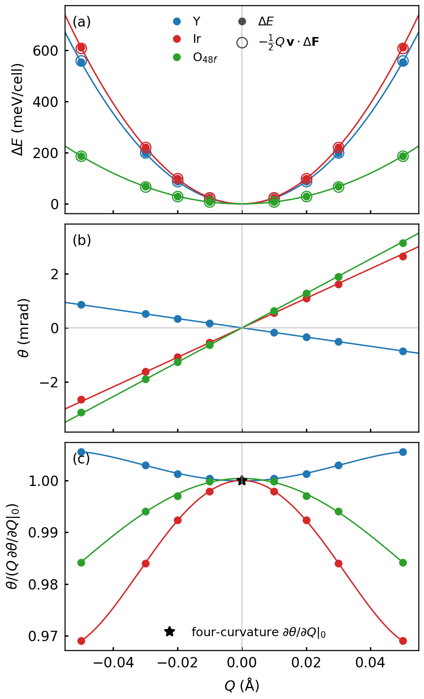
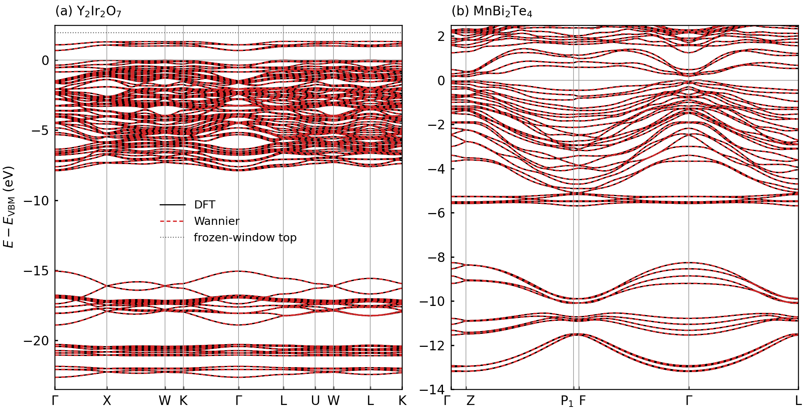
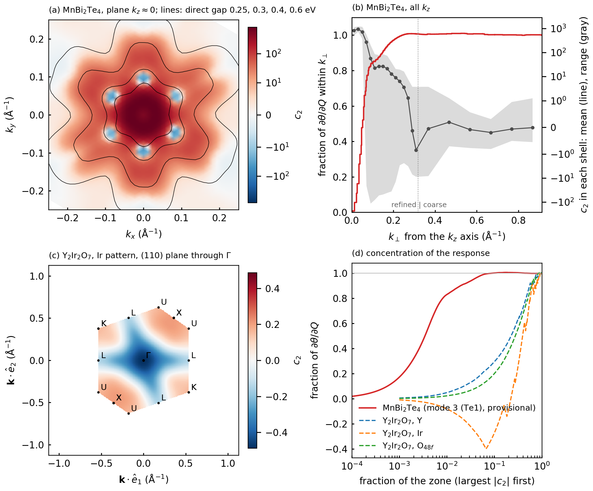

# Meeting notes: progress since 2026-10-14 (prepared 10-21)

## Summary

1. **YIO dθ/dQ is final.** All three numbers moved since last week, by −5% (mode 1), +1% (mode 2) and −3% (mode 3).
   Three things changed, each tested on its own (§2):
   - every SCF at conv_thr 1e-10;
   - energy windows inside a measured plateau;
   - an undistorted Wannier model built the same way as the displaced ones.
2. **θ(Q) is linear, and an independent route confirms the slope.** The Chern–Simons 3-form gives θ(Q) directly
   at Q = 0.01–0.05 Å. Its Q → 0 slope matches the four-curvature result to ≤ 0.04% for all three modes (§3, Fig. 2).
3. **MBT phonons are done.** The four T₂⁻ modes are at 18.0, 82.8, 129.0 and 143.5 cm⁻¹. The lowest is the rigid
   interlayer breathing mode, and it is axion-active. Its stiffness is about half the experimental chain-model value
   (§4).
4. **MBT dθ/dQ needs a special k mesh.** The integrand sits in a thin tube around the k_z line through Γ, where the
   bands are inverted and the gap is ~0.2 eV. Uniform meshes don't converge. A refined tube mesh gives
   6.4 rad/Å for mode 3, converged to ~0.1%, but this is a provisional run with a conv_thr 1e-7 mode SCF (§5).
   - **Production rebuild:** all MBT structures are being redone at 1e-10.
   - **When:** modes 1–2 ~10-21 morning; modes 3–4 and the second amplitude ~10-22.
5. **The Wannier bands match DFT where it matters (§6, Fig. 1).**
   - **YIO:** within 2.3 meV inside the frozen window, and 0.1 meV at the gap edges.
   - **MBT:** within 13 meV for the occupied bands.
   - **The large misfits are in high conduction bands:**
     - YIO's e_g bands are 0.47 eV off;
     - MBT's bands under its frozen-window top are off by up to 0.3 eV.

     These don't enter dθ.
   - **One open MBT item:** near Γ but off the k_z line, the gap-edge bands are off by 10 meV between mesh points.
6. **Where in the zone the response comes from (§7, Fig. 3).**
   - **MBT:** 84% of dθ/dQ comes from 1.3% of the zone.
   - **YIO:** spread out, with large sign cancellations.

Figures: `2026-10-21_figures/`. They are copies of what the notebooks in `analysis/figures/` produce.

---

## 1. Conventions (unchanged)

- **Displacement:** Q is the displacement per Cartesian component along the raw SMODES vector (entries ±1).
- **The response:** ∂θ/∂Q = ∫ c₂ d³k. The integrand c₂ ∝ ε Tr[𝔅𝔅] contains the k–k and k–Q curvature of the
  occupied bands.
- **Two estimates:** the "undistorted end" evaluates the k-space quantities in the undistorted model, the
  "displaced end" in the displaced one. Both use the same secant ∂_Q H, A.
- **Basis patterns:**
  - **YIO:** Γ₂⁻ appears once on each Wyckoff orbit. So pattern 1 moves only Y, 2 only Ir, and 3 only O(48f). Each
    pattern's response is that sublattice's axion charge times N|v|.
  - **MBT:** the T₂⁻ patterns move Mn, Bi, Te1 (outer, at the van der Waals gap) and Te2 (inner, bonded to Mn).
    Partner atoms in the two septuple layers move oppositely.

## 2. YIO: what moved the numbers, and the final values

| mode (sublattice) | last week (10-12) | **now** | change |
|---|---|---|---|
| 1 (Y) | −0.0180 | **−0.017145** | −4.8% in magnitude |
| 2 (Ir) | +0.0542 | **+0.054737** | +1.0% |
| 3 (O 48f) | +0.0655 | **+0.063766** | −2.6% |

Units are rad/Å.
- **Last week's column:** nk 12, SCFs at conv_thr 1e-7, frozen window up to 14.396 eV, undistorted model from
  atomic trials.
- **Now:** Q → 0 limit, nk 10, SCFs at 1e-10, frozen window up to 12.422 eV, undistorted model built through the
  mode pipeline (the "self-test base").

### Three causes, each tested on its own

**(a) The displaced structure's SCF threshold.** At fixed production windows, moving 1e-7 → 1e-10 changes dθ/dQ
by +0.5%, −0.6% and −2.3% (modes 1–3).
- **Why it matters:** a density error δ in the displaced SCF enters the finite difference as δ/Q.
- **The undistorted SCF's threshold:** it barely matters (≤ 2e-5 relative), because the k-space quantities are
  evaluated there and its error is not divided by Q.
- **Rule from now on:** every structure that feeds dθ uses 1e-10.

**(b) Energy windows: a plateau, and last week's frozen top was outside it.** 18 Wannier pairs at Q = 0.01 Å, each
window set with its own undistorted model:

| frozen top / outer top (eV) | Ω_I (Ų) | mode 1 | mode 2 | mode 3 |
|---|---|---|---|---|
| 10.786 / 22.644 | 116.84 | −0.75% | +0.25% | −0.56% |
| **12.422 / 22.644** (chosen) | 117.10 | reference | reference | reference |
| 13.120 / 22.644 | 117.37 | −0.24% | +0.02% | +0.06% |
| 12.422 / 19.993 | 119.47 | +0.44% | +0.10% | −0.17% |
| 12.422 / 24.522 | 117.34 | −0.14% | −0.00% | −0.03% |
| 14.396 / 24.522 (last week) | 159.25 | +5.56% | −1.20% | +0.34% |

- **The plateau:** frozen tops 10.8–13.1 eV (0.34–2.68 eV above the valence-band maximum) and any outer top agree
  to ≤ 0.75%.
- **Last week's window was the outlier:** freezing up to 14.396 eV forces in states that the set (Y p, Ir d, O s p)
  describes poorly. The gauge-invariant spread jumps 117 → 159 Ų and mode 1 moves 5.6%.
- **How the edges are now chosen:** each edge sits in a gap open in all 13 NSCFs of the amplitude series, with the
  same number of bands below it at every k. A band crossing an edge between the undistorted and displaced structures
  changes the frozen subspace on a whole k-star.

**(c) Build the undistorted model the same way as the displaced ones.**
- **How a displaced model is built:** its `.amn` projects the displaced Bloch states onto the undistorted Wannier
  functions.
- **The test:** the same route applied to the undistorted Bloch states (Q = 0) should give back the undistorted
  model. It doesn't quite: Ω_I is 116.42 vs 117.10 Ų in YIO and 344.5 vs 325.5 Ų in MBT (+6%).
- **Consequence:** every displaced model tends, as Q → 0, to this "self-test" model rather than to the model it is
  paired with.
- **The fix:** use the self-test model as the undistorted one. Then the two YIO endpoint estimates meet as Q → 0
  (gap c₀ = 0.08% / 0.002% / 0.009%; it was 1.0% with the atomic-trial model). The remaining difference is the
  ordinary c₂Q².

**Axion charges** (Table V in main2): Y −0.0025, Ir +0.0079, O(48f) +0.0053 rad/Å.

**Physical Γ₂⁻ modes** (1e-10 force constants, production slopes; Table VI):

| ω (cm⁻¹) | Y / Ir / O share | dθ/dq (rad Å⁻¹ amu⁻½) | per Å | δθ_zp (rad) |
|---|---|---|---|---|
| 228.6 | 0.04 / 0.67 / 0.29 | −0.00204 (was −0.00206) | −0.024 | 5.5e-4 |
| 328.3 | 0.80 / 0.02 / 0.19 | +0.00118 (was +0.00122) | +0.010 | 2.7e-4 |
| 471.6 | 0.01 / 0.00 / 0.99 | −0.00415 (was −0.00427) | −0.017 | 7.8e-4 |

## 3. YIO: θ(Q) and the independent check of the slope

**Fig. 2** (paper Fig. 5; `analysis/figures/fig5.ipynb`).

**(a) Energy along each pattern, from energies and from forces.**
- **The comparison:** ΔE(Q) (filled) against −½Q v·ΔF (open).
- **Harmonic:** to ≤ 1.5% at 0.05 Å.
- **Energy and force agree:** to ≤ 0.8% at every Q.
- **The quartic term:** mode 1 stiffens, mode 2 softens, mode 3 stays harmonic.
- **Frequencies from these force constants:** 228.6 / 328.3 / 471.6 cm⁻¹.

**(b) θ(Q) from the Chern–Simons 3-form against the four-curvature slope.**
- **Points:** θ_CS(displaced) − θ_CS(undistorted), at nk 12 (job 214446). θ_CS(undistorted) = 9e-11, so it is zero.
- **Lines:** Q·∂θ/∂Q|₀, with the slope from §2.

**(c) The check itself: θ(Q)/Q divided by the slope.**
- **Why it is a test:** θ(Q)/Q = ∂θ/∂Q|₀ + O(Q²). So its Q → 0 intercept is an independent estimate of the slope.
- **The intercepts:** a + bQ² + cQ⁴ fits reach 1 to −0.008% / 0.000% / +0.04%.
- **Nonlinearity:** the departure from 1 at 0.05 Å is 0.6% / 3.1% / 1.6%.
- **What the check covers:**
  - Both routes use the same H(R) and A(R). So it tests the curvature code, the treatment of the Q direction and the
    k sums, not the Wannier model.
  - The 3-form gives the same numbers on 10³ and 12³ meshes to 1e-6. So the four-curvature integral on 10³ is also
    converged.

## 4. MBT phonons: the soft mode is the interlayer breathing mode

- **The soft mode (10-14 → 10-15):**
  - **The problem:** the first pass (Q = 0.01 Å, 1e-7) gave the lowest mode at −20 ± 13 cm⁻¹, unresolved.
  - **Diagnosis:** it is the rigid antiphase motion of the two septuple layers (overlap 0.9995), so its stiffness is
    a small remainder of large numbers.
  - **Resolved:** dedicated rigid-layer SCFs at 0.03 and 0.05 Å are quadratic to 0.1%, giving 18.0 cm⁻¹ (0.54 THz).
- **What the mode is:** the longitudinal acoustic branch at the nonmagnetic zone boundary, folded to Γ by the
  antiferromagnetic doubling. It is T₂⁻, so it is axion-active. Being the lowest-frequency mode, it has the largest
  amplitude per unit energy.
- **Basis modes at 0.03 Å, 1e-10:** energy-to-force ratio 1.000–1.001 in all four. The earlier Mn ratio of 1.24 was
  SCF noise, not a Hubbard-force error.
- **Amplitude series** (4 modes × 0.01–0.05 Å, 1e-10):
  - Harmonic within 0.5% at 0.05 Å.
  - Q → 0 frequencies **18.02 / 82.78 / 128.95 / 143.52 cm⁻¹**.
- **Against experiment (10-16):**
  - **Gap counting fixed:** there are two van der Waals gaps per cell, so K = k/8, not k/4.
  - **Our stiffness:** 2.9–3.0 × 10¹⁹ N/m³.
  - **Bartram et al. (2022):** they fit 5.7 × 10¹⁹ N/m³ to finite-flake breathing modes.
  - **Prior DFT:** a value close to ours, 2.85 × 10¹⁹ N/m³.
  - **For the paper:** report the computed frequency, and state the comparison and the chain-model assumptions.

## 5. MBT dθ/dQ: a small-gap tube along k_z

**Uniform meshes don't converge.** For mode 3 (provisional), the undistorted-end estimate is 48, 21, 12, 5.8 and
2.7 rad/Å at nk 4, 6, 8, 12 and 16.
- **Why:** c₂ ≈ 5×10² at Γ and 1.1×10³ at Z, against a zone average of about 3.
- **Where it is large:** all along the k_z line through Γ. MBT bands barely disperse along k_z (c = 81.85 Å), so the
  direct gap stays ≈ 0.2 eV over the whole line.

**The tube mesh** (`make_klist_tube.py`; weights in `assemble_tube.py`):
- **Basis:** the integral is over one primitive cell of the reciprocal lattice. It is written in the basis
  g₁ = b₁, g₂ = b₂, g₃ = b₁ + b₂ + b₃. That change of basis keeps the volume, so the integral is unchanged.
  - **The k_z axis:** g₃ is the c* direction, so the k_z axis through Γ is the line u₁ = u₂ = 0.
  - **The cell:** a rhombic prism, with in-plane angle 120°. It is not the hexagonal Wigner–Seitz zone, but it
    covers the same volume once. The integrand is periodic, so any primitive cell gives the same integral, and
    nothing has to match the zone edge.
  - **The planes are slightly tilted:** b₁ and b₂ have a small k_z component. Across the refined region k_z changes
    by only ±0.03 Å⁻¹.
- **Planes:** N₃ evenly spaced planes of constant u₃: 8 in production, 32 in the provisional run.
- **In each plane:** a 16×16 coarse grid in (u₁, u₂), spacing h = 1/16, which is 0.105 Å⁻¹.
- **Refinement:** the 7×7 cells nearest the axis (within 3 cells, any direction) are each replaced by an M×M
  sub-grid, with spacing h/M. M is 4 in production and 8 in the provisional run, so the finest spacing is
  0.013 Å⁻¹ there.
  - **Nested sub-grids:** each sub-grid contains the coarse point, and the h/2 and h/4 sub-grids are subsets of
    the h/8 one. One run therefore gives the estimates for M = 1, 2, 4, 8.
  - **Shape of the refined region:** in Cartesian k it is a 120° rhombus centred on the axis. Its largest inscribed
    circle has radius 0.32 Å⁻¹, so it is not a cylinder. It is marked "refined | coarse" in (b).
- **Weights:** each coarse point outside the refined region gets h², each sub-grid point inside gets (h/M)², and all
  are divided by N₃.
  - **Total weight:** 1.
  - **The rule:** the periodic rectangle rule, applied piecewise.
  - **The spacing jump at the boundary:** it costs little, because c₂ there is ~1% of its peak. Widening the region
    tests this.
- **Count:** 8 × (49 × 16 + 207) = 7,928 k per pair.
- **Convergence:** each of these changes the result by ≤ 0.1%:
  - refining further (m = 4 → 8: 0.04%);
  - more planes (8 vs 32: 0.015%);
  - a wider refined box (0.08%).
- **Mode 3 at Q = 0.01 Å, provisional:** 6.37 / 6.47 rad/Å (undistorted / displaced end). Provisional because the
  displaced SCF was at 1e-7.

**The production rebuild (all 1e-10).**
- **Structures:** the undistorted one, and modes 1–4 at Q = 0.01 Å plus mode 3 at 0.03 Å. The second amplitude
  separates c₀ from c₂Q².
- **Done:**
  - DFT for the undistorted structure and modes 1–2;
  - the undistorted Wannier model (Ω_I 325.5) and its self-test model (344.5);
  - DFT bands.
- **Running (10-21 02:40):**
  - Wannier for modes 1–2 (~10 h so far);
  - the remaining NSCFs, at k 33–37 of 64 per pool, which finish ~10-21 13:00–16:00.
- **dθ:** set up as held jobs (stage → 10-task c₂ array → assemble).
  - Modes 1–2: within ~1–2 h of their Wannier jobs.
  - Modes 3–4: ~10-22.
- **Kept for later:** the per-k c₂ and gap of every pair, for the k-resolved figure.

## 6. Bands: DFT against the Wannier interpolation

**Fig. 1** (paper Fig. 3; `analysis/figures/fig3.ipynb`).
- **The comparison:** DFT bands (pw.x `bands`, from the 1e-10 SCFs) against the production Wannier models of the
  undistorted structures (the self-test models, H(R) from the `.chk`).
- **The path:** the `.win` k-path, mostly off the 8×8×8 mesh.
- **The figure:** zero at the valence-band maximum. Each panel goes down to the lowest occupied Wannier band
  (O 2s, Te 5s).

| | YIO | MBT |
|---|---|---|
| occupied bands | ≤ 2.3 meV | ≤ 13 meV |
| bands bordering the gap | ≤ 0.1 meV | ≤ 12 meV; 0.05 meV along Γ–Z |
| gap (DFT) | 0.69 eV, indirect L → Γ; direct ≥ 0.95 eV | 163 meV, indirect (VBM just off Γ, CBM at Z); 198 meV on the mesh |
| where the misfit is | above the frozen window: Ir e_g bands +0.47 eV on average (Y 4d is not in the set) | under the frozen top (VBM + 2.5–3 eV): up to 0.3 eV |

**Does the conduction-band misfit make dθ wrong? No, with one open MBT item.**
- **Why not, in principle:** ∂θ/∂Q depends only on the occupied states. The empty part of the Wannier space only
  completes the basis: it decides how the curvature splits into internal, cross and external parts, not their sum.
  What matters is how well the occupied states are interpolated between mesh points, and the near-gap band errors
  measure that.
- **YIO bears this out:**
  - The window plateau (§2b) shows the misfit doesn't enter at the 0.75% level.
  - The one window that moved dθ by 5.7% also made the occupied bands worse: 6.5 meV against 2.3 meV.
- **The open MBT item:** near Γ but off the k_z line, inside the tube that dominates the integral, the gap-edge bands
  are off by up to 10 meV midway between mesh points, and the direct gap there is 3–4 meV (~2%) too small.
  - **What it is:** 8×8×8 interpolation error, not a window effect.
  - **Its effect on dθ:** not measured yet.
  - **Tests:** an MBT window test (cheap: reuses the existing files), and dθ against a denser Wannier mesh (one more
    NSCF per structure, ~1 day each).

**Band physics (now in the paper).**
- **YIO:**
  - **The edges:** both gap edges are Ir 5d–O 2p states of the j_eff = 1/2 manifold (about half Ir at the valence
    top, three quarters at the conduction bottom), split by U and the all-in-all-out order.
  - **No inversion:** the composition is the same at Γ, X, L and W, as expected for a trivial insulator.
- **MBT:**
  - **The inversion is at Γ:** the top valence doublet is parity-even with 72% p_z character (Bi 37%, outer Te
    53%), and the lowest conduction doublet is odd.
  - **Elsewhere the order is atomic:** at F and L, Te states form the valence top and the even Bi p_z states sit
    ~1 eV up.
  - **The parity count:** the occupied bands at Γ have one even Kramers doublet more than the atomic limit (48/34
    against 46/36). That single exchange gives η₄ = 2, i.e. θ = π.

## 7. Where in the zone the response comes from

**Fig. 3** (draft; `analysis/figures/c2_distribution.ipynb`).
- **Why the map means something:** Tr[𝔅𝔅] doesn't depend on the gauge at each k (unlike the Chern–Simons 3-form
  density). So its distribution is physical for a given interpolation.
- **Plotted quantity:** the mean of the two endpoint estimates.

**(a) MBT, mode 3 (provisional run).** c₂ on one plane across the k_z axis, plotted against Cartesian (k_x, k_y).
- **Extent:** only the refined part of the tube mesh, |k_x|, |k_y| ≤ 0.25 Å⁻¹ around Γ. The in-plane zone extends
  to 0.84 Å⁻¹ at the hexagon edge, so this is about a tenth of the plane. The white corners lie outside the refined
  box.
- **The plane:** k_z varies by ±0.03 Å⁻¹ across it, against a k_z period of 0.23 Å⁻¹. Along k_z, c₂ varies smoothly
  but not negligibly: on the axis it is 5×10² at Γ and 1.1×10³ at Z.
- **Contours:** the direct gap (lowest conduction minus highest valence at each k) at 0.25, 0.3, 0.4 and 0.6 eV.
- **Colour scale:** symmetric-log, so the six small negative lobes are visible.
- **What it shows:** a hexagonally warped core with c₂ > 10² that follows the 0.25 eV gap contour, and six negative
  lobes about 0.1 Å⁻¹ out.

**(b) MBT, all k_z planes.**
- **Red:** the fraction of ∂θ/∂Q from k points within k⊥ of the k_z axis. k⊥ is the Cartesian distance to the
  nearest periodic image of the axis.
  - **Why it ends at 1:** it is normalized by the total. The x axis now runs to the largest k⊥ in the zone,
    0.91 Å⁻¹, between the hexagon edge (0.84) and corner (0.97).
  - **The overshoot:** it peaks at 1.01 near 0.3 Å⁻¹ and drifts back to 1. Points beyond 0.6 Å⁻¹ fill 53% of the
    zone but add −0.7%.
- **Gray band and line:** c₂ grouped into shells of k⊥. The shells are 0.02 Å⁻¹ wide inside the refined region and
  0.1 Å⁻¹ outside, where the mesh is coarse. The line is the weighted mean c₂ of each shell, which is what the red
  curve integrates. The band is the range of c₂ in the shell, over all planes and directions.
  - **Why the previous version had vertical stripes:** it plotted every k point at its own k⊥. Each in-plane mesh
    point appears in all 32 planes at exactly the same k⊥, and so do its symmetry partners. So each k⊥ held about
    192 points (32 planes × ~6 directions), stacked in a column.
- **Numbers:** 48% of ∂θ/∂Q within 0.05 Å⁻¹ (0.3% of the zone), 84% within 0.1 (1.3%), 97% within 0.2 (5%).
- **Not cylindrically symmetric:** the shells average over direction, and the band shows how much c₂ varies
  around them.
  - At k⊥ = 0.03–0.04 Å⁻¹, c₂ is 793–815: nearly isotropic.
  - At 0.07–0.09 Å⁻¹ it is −4 to 166: the six negative lobes against the ridges between them.
  - At 0.15–0.17 Å⁻¹ it is 16–83.
  - The pattern is sixfold, following the hexagonal warping of the gap contours in (a).

**(c) YIO, Ir pattern (Γ₂⁻ basis pattern 2: the four Ir along local ⟨111⟩).**
- **The plane:** the (110) plane through Γ, which contains Γ, X, L, K and U. The map covers the whole cross-section
  of the first Brillouin zone in that plane (the hexagon), not the whole 3D zone.
- **Resolution:** interpolated with a periodic cubic spline from the 10³ mesh of the production pair.
- **What it shows:** c₂ ~ ±0.1–0.5, with no hot spot. Negative in a cross through Γ along Γ–L, positive toward X, U
  and K. The negative regions cancel 79% of the positive.

**(d) How concentrated the response is, both materials.**
- **How it is built:** sort all k points by |c₂|, largest first, and accumulate.
  - **x:** the fraction of the zone those points occupy. MBT uses the tube weights; YIO weights each mesh point 1/1000.
  - **y:** their cumulative contribution to ∂θ/∂Q, divided by the total.
- **Reading it:**
  - **MBT:** 50% from 0.35% of the zone, 80% from 0.8%, 90% from 1.9%.
  - **YIO:** 50% needs 23–39% of the zone and 80% needs 46–57%.
  - **The Ir curve:** it first dips to −0.4, because its largest |c₂| values are negative.

**Recommendation for the paper: show the basis patterns, not physical modes.**
- **Why:** in YIO each pattern is one sublattice, so each map is that sublattice's axion charge resolved in k. That
  is the quantity the paper reports and what the physics is about.
- **The modes are combinations:** a physical mode's map is the eigenvector-weighted sum of these, so it shows no new
  physics. It also mixes positive and negative regions of different sublattices.
- **Physical modes belong in:** the coupling and detection tables (Table VI, Fig. 8).
- **MBT:** the T₂⁻ patterns are also sublattice patterns (Mn, Bi, Te1, Te2).

**To finish the figure:**
- MBT from the 1e-10 chain (all four patterns);
- a dense YIO (110) plane per pattern (cluster, since a YIO pair needs > 18 GB to load);
- place it, merging the planned Figs. 6d and 7c.

## Where the details live

- **Log:** `notes/log/2026-10-17_yio_amplitude_series.md`. It covers the series, windows, self-test, θ(Q), MBT tube,
  bands, c₂ maps and paper updates.
- **MBT phonons:** `notes/log/2026-10-14_mbt_t2m_dynmat.md`, `2026-10-15_mbt_rigid_layer_mode.md`,
  `2026-10-16_mbt_interlayer_stiffness.md`.
- **Scripts:**
  - `archive/diagnostics/2026-10-21_yio_mode_couplings/`;
  - `archive/diagnostics/2026-10-21_yio_band_edges/`;
  - `archive/diagnostics/2026-10-21_mbt_band_inversion/`;
  - `archive/diagnostics/2026-10-19_yio_cs_theta_series/`;
  - `analysis/phonon_frequencies.ipynb`;
  - `analysis/amplitude_series.ipynb`.
- **Status:** `notes/README.md`.
